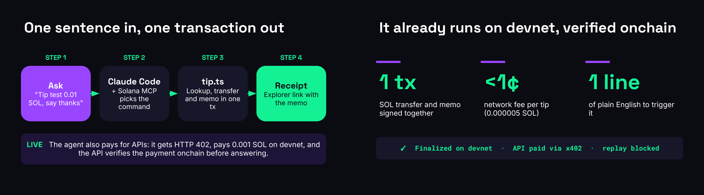
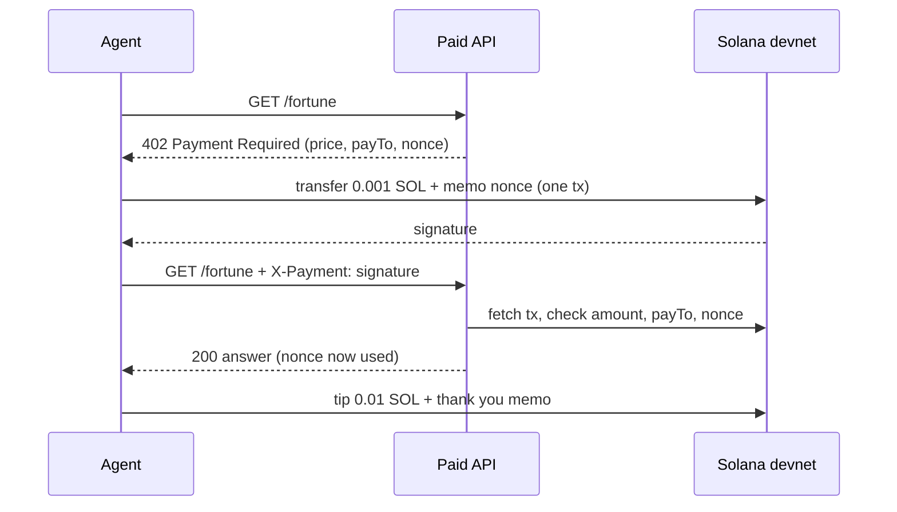

<p align="center">
  
</p>

<h1 align="center">Agent Tip Jar</h1>

<p align="center"><b>An AI agent with a Solana wallet. It pays for APIs over HTTP 402 and tips people, with an onchain receipt for every payment.</b></p>

<p align="center">
  
  
  
  
</p>

<p align="center"><a href="https://estebananez.github.io/agent-tip-jar/"><b>▶ Live demo page</b></a> · Runs on Solana devnet. No real funds involved.</p>


## Slides

- [PDF in this repo](docs/agent-tip-jar-slides.pdf)
- [Google Slides](https://docs.google.com/presentation/d/1P4QarRl_2VatntOJx0iyyX253DQCeFXUPVcd2G0peBY/edit)

## Demo

One command: the agent hits a paid API, pays it on Solana, gets the answer, then tips a person.

```text
$ npm run agent
🧾 402 Payment Required: 0.001 SOL to 835ZAX5T3TKPzMAXenQrFx2aTZcPQwv1vnkZABgBLrCQ (memo 7ef209ac6941364b)
💳 Paid 0.001 SOL
🔮 Paid answer: A small tip today compounds into a big thank you tomorrow.
💸 Tipped test 0.01 SOL: "paid via x402 + tipped onchain"
```

Real devnet receipts from that run:

- [API payment](https://explorer.solana.com/tx/5aM8rR5Ecpoca5hfQMS2ZXRR9Z3aAi2S8XMZ97AgRrMnQnMfhFa9X4summNddgoGW368xvBurtkFsbJxaVm4LeWN?cluster=devnet) (0.001 SOL, memo nonce `7ef209ac6941364b`)
- [Tip](https://explorer.solana.com/tx/FF1pg7zC7azFAYgjiQZrVAnk3pY9zin1VXho6guS5zCA9UKktvSTeasJyzZQsfzxo8jZbVFnp1qHKdsvuAzWqqh?cluster=devnet) (0.01 SOL, "paid via x402 + tipped onchain")
- [First tip from plain English](https://explorer.solana.com/tx/3rjySbBGocuFV9xqUsHbCxyt9WUHFhCmUDxcvGQw2fSfL17axDLgse7fUGWnDW56rpr9ycUQeCGqkxxX9auR3PG2?cluster=devnet) ("thanks for the workshop")

Every transfer and its memo land in one transaction, so the reason for each payment is permanently attached to it.

## How it works



1. **Ask in plain English.** Tell Claude Code something like "tip test 0.01 SOL and say thanks".
2. **Claude Code + Solana MCP runs it.** Claude uses the Solana Developer MCP for current docs and picks the right `npm run tip` command.
3. **One transaction.** `tip.ts` looks up the handle in `tips.json`, then sends a System program transfer plus a Memo program instruction in one transaction.
4. **Explorer receipt.** The script prints a Solana Explorer link so you can verify the tip and memo onchain.

### Agent pays for APIs (x402 on devnet)

`npm run agent` shows an agent paying for an API by itself, then tipping:

1. The agent calls `GET /fortune` on our paid API (`server.ts`) and gets **HTTP 402** with a price (0.001 SOL), a `payTo` address and a one-time memo nonce.
2. It pays automatically with the same transfer + memo logic as `tip.ts`, in one transaction. It refuses anything that isn't SOL on devnet or costs more than 0.01 SOL.
3. It retries with `X-Payment: <tx signature>`. The server fetches that transaction on devnet, checks it paid at least the price to `payTo` with the matching nonce, then returns the answer. Nonces are single use, and reused or unknown signatures are rejected.
4. It tips `test` 0.01 SOL with the memo "paid via x402 + tipped onchain" and prints both receipts.

### Payment flow



## Quick start

Requires Node.js 22.6 or newer (Node 24 recommended) so `.ts` files run directly.

```bash
git clone https://github.com/EstebanAnez/agent-tip-jar.git
cd agent-tip-jar
npm install
```

Create your sender wallet:

```bash
npm run keygen
```

This writes `devnet-keypair.json` and prints its address. Paste that address into [faucet.solana.com](https://faucet.solana.com) and request devnet SOL.

Send a tip:

```bash
npm run tip test 0.01 "thanks"
```

Run the paid API and let the agent pay for it (two terminals):

```bash
npm run server
```

```bash
npm run agent
```

Add your own handles by copying `tips.example.json` to `tips.json` and filling in devnet addresses.

> `devnet-keypair.json` holds your private key and is git-ignored. Never commit it.

## Tech stack

- [@solana/kit](https://github.com/anza-xyz/kit) 8 with plugin clients (`@solana/kit-plugin-rpc`, `@solana/kit-plugin-signer`)
- Memo program (`@solana-program/memo`) for the onchain note, plus `@solana-program/system` for the transfer
- [Solana Developer MCP](https://mcp.solana.com) for up-to-date docs inside the agent
- [Claude Code](https://claude.com/claude-code) as the agent

## Limitations

- Devnet only. The agent refuses anything that is not SOL on devnet or costs more than 0.01 SOL.
- The server keeps issued nonces and used signatures in memory, so a restart clears them. A real deployment would store them in a database.
- The payment format is x402 style, not a full x402 spec implementation. pay.sh is the planned production path (see below).

## pay.sh (x402) status

Using `pay --sandbox`, the agent received the HTTP 402 challenge from `debugger.pay.sh` and funded a sandbox wallet. The final payment is still blocked: pay.sh's hosted balance service times out (HTTP 504), so pay reads the wallet as empty and declines to pay. A retry on 2026-11-21 failed the same way. No mainnet funds were used.

While that is blocked, the paid API flow runs on our own x402-style server on devnet (see "Agent pays for APIs" above). Switching the agent to pay.sh later only changes how it pays, not the flow.

## Roadmap

- **Finish pay.sh paid calls:** swap our devnet x402-style payment for pay.sh once its balance service is reachable.
- **Pay per answer API:** an API other agents can buy answers from through x402.

## Built at

UBC 2026 (UT Austin), Solana workshop by [brimigs](https://github.com/brimigs/workshop).

## License

[MIT](LICENSE)
