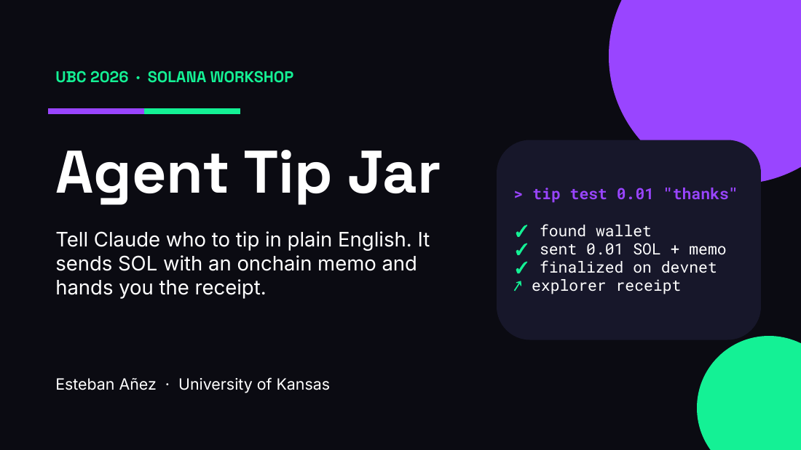

<p align="center">
  
</p>

<h1 align="center">Agent Tip Jar</h1>

<p align="center"><b>Tell Claude who to tip in plain English. It sends SOL with an onchain memo and hands you the receipt.</b></p>

<p align="center">
  
  
  
  
</p>

<p align="center">Runs on Solana devnet. No real funds involved.</p>



## Slides

- [PDF in this repo](docs/agent-tip-jar-slides.pdf)
- [Google Slides](https://docs.google.com/presentation/d/1P4QarRl_2VatntOJx0iyyX253DQCeFXUPVcd2G0peBY/edit)

## Demo

A real devnet tip of 0.01 SOL to `test` with the memo "thanks for the workshop":

[View the transaction on Solana Explorer](https://explorer.solana.com/tx/3rjySbBGocuFV9xqUsHbCxyt9WUHFhCmUDxcvGQw2fSfL17axDLgse7fUGWnDW56rpr9ycUQeCGqkxxX9auR3PG2?cluster=devnet)

The transfer and the memo land in a single transaction, so the message is permanently attached to the payment.

## How it works


1. **Ask in plain English.** Tell Claude Code something like "tip test 0.01 SOL and say thanks".
2. **Claude Code + Solana MCP runs it.** Claude uses the Solana Developer MCP for current docs and picks the right `npm run tip` command.
3. **One transaction.** `tip.ts` looks up the handle in `tips.json`, then sends a System program transfer plus a Memo program instruction in one transaction.
4. **Explorer receipt.** The script prints a Solana Explorer link so you can verify the tip and memo onchain.

## Quick start

Requires Node.js 22.6 or newer (Node 24 recommended) so `.ts` files run directly.

```bash
git clone https://github.com/EstebanAnez/agent-tip-jar.git
cd agent-tip-jar
npm install
```

Create your sender wallet:

```bash
npm run keygen
```

This writes `devnet-keypair.json` and prints its address. Paste that address into [faucet.solana.com](https://faucet.solana.com) and request devnet SOL.

Send a tip:

```bash
npm run tip test 0.01 "thanks"
```

Add your own handles by copying `tips.example.json` to `tips.json` and filling in devnet addresses.

> `devnet-keypair.json` holds your private key and is git-ignored. Never commit it.

## Tech stack

- [@solana/kit](https://github.com/anza-xyz/kit) 8 with plugin clients (`@solana/kit-plugin-rpc`, `@solana/kit-plugin-signer`)
- Memo program (`@solana-program/memo`) for the onchain note, plus `@solana-program/system` for the transfer
- [Solana Developer MCP](https://mcp.solana.com) for up-to-date docs inside the agent
- [Claude Code](https://claude.com/claude-code) as the agent

## pay.sh (x402) status

Work in progress. Using `pay --sandbox`, the agent received the HTTP 402 challenge from `debugger.pay.sh` and funded a sandbox wallet. The final payment is blocked by a 504 timeout from pay.sh's hosted balance service, so pay reads the wallet as empty and declines to pay. No mainnet funds were used.

## Roadmap

- **Finish pay.sh paid calls:** let the agent pay for an API call over HTTP 402, then tip onchain in the same flow.
- **Pay per answer API:** an API other agents can buy answers from through x402.

## Built at

UBC 2026 (UT Austin), Solana workshop by [brimigs](https://github.com/brimigs/workshop).

## License

[MIT](LICENSE)
